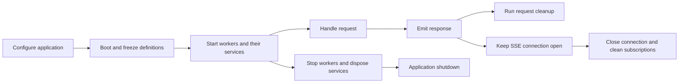

# User guide

[Project home](../README.md) · [Examples](../examples/README.md) · [API reference](api-reference.md)

This guide covers the current Oktaax API. Snippets showing `$app` assume that an
`Application` or `Oktaax` instance has already been constructed. Complete runnable
programs live in [examples/guide](../examples/guide).

## Learning path

1. [Getting started](getting-started.md): requirements, first server, curl requests,
   project layout, and choosing a runtime.
2. [Routing and middleware](routing.md): methods, dynamic paths, middleware order,
   authentication, and CSRF.
3. [Requests and validation](requests.md): input precedence, JSON, rules, and uploads.
4. [Responses and views](responses.md): return values, JSON, cookies, files,
   templates, custom result handlers, and Inertia payloads.
5. [Lifecycle and services](lifecycle.md): bootstrap, lazy factories, worker
   resources, request cleanup, connection cleanup, and active application scopes.
6. [Streaming and SSE](streaming.md): incremental writes, subscribers, timers,
   disconnects, and cleanup.
7. [Tasks, events, and timers](tasks-events.md): task results and failures,
   worker events, IPC, and scheduling.
8. [WebSocket](websocket.md): server setup, JSON packets, browser clients, and
   connection hooks.
9. [HTTP client](http-client.md): promises, coroutine execution, request options,
   consuming and closing response bodies.
10. [Errors and debug pages](errors.md): default policy, JSON errors, diagnostics,
    and custom page templates.
11. [Configuration and operations](configuration.md): defaults, runtime
    capabilities, environment variables, TLS, reverse proxies, and shutdown.
12. [Testing and troubleshooting](testing.md): test a handler, verify the examples,
    and diagnose common errors.

## Reference material

- [Database and Eloquent](database.md): request-scoped models and transactions.
- [Console, Struct, and utilities](utilities.md)
- [Public API reference](api-reference.md)
- [Migration from removed APIs](migration.md)
- [Internal architecture and ownership](architecture.md)
- [Example catalog with requests and expected results](../examples/README.md)
- [Illuminate Database + SQLite integration](../examples/guide/database/README.md)
- [Eloquent + MySQL worker connection pool](../examples/guide/mysql/README.md)

## Working model

An application defines routes and services before boot. A runtime starts workers.
Each request executes middleware, a handler, response emission, and cleanup.
Long-lived connections keep their own cleanup scope after the handler returns.

Routes, permanent observers, configuration, and service definitions must be
registered before boot. PHP objects can live across many requests in a worker;
request-specific state belongs on the request or in its cleanup scope.
